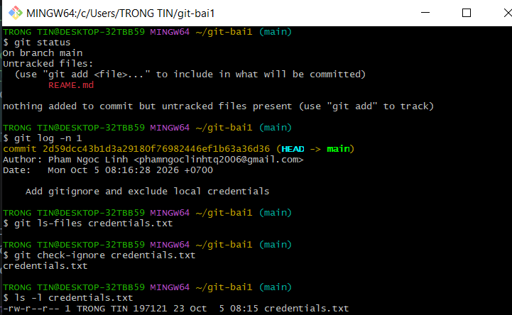

# Bài 4: Quản lý .gitignore và sửa commit bằng amend

## 1. Các bước thực hiện

Tạo credentials.txt chứa dữ liệu giả và commit để mô phỏng
việc đưa nhầm tệp chứa thông tin bảo mật vào Git.

```bash
echo "password=demo_only_123" > credentials.txt
git add credentials.txt
git commit -m "Add demo credentials by mistake"
printf '\ncredentials.txt\n' >> .gitignore
git rm --cached credentials.txt
git add .gitignore
git commit --amend -m "Add gitignore and exclude local credentials"
```

## 2. Giải thích

- .gitignore ngăn Git thêm credentials.txt vào các commit tiếp theo.
- git rm --cached gỡ tệp khỏi vùng theo dõi, giữ nguyên tệp trên đĩa.
- git commit --amend cập nhật nội dung và thông điệp commit gần nhất.

## 3. Kết quả kiểm tra

```bash
git status
git log -n 1
git ls-files credentials.txt
git check-ignore credentials.txt
ls -l credentials.txt
```

Dán kết quả thực tế của các lệnh kiểm tra tại đây.

